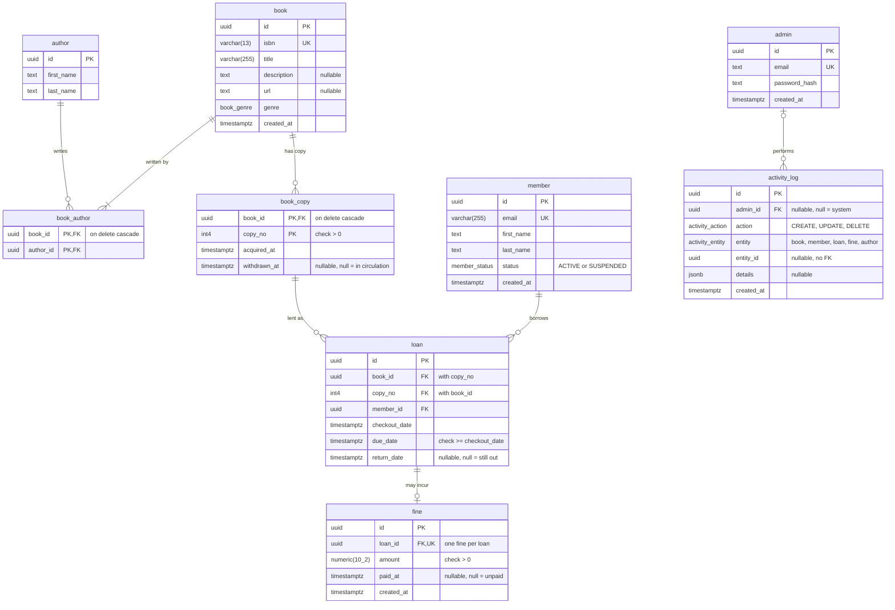

# LibExpress table diagram

Matches `prisma/schema.prisma` after the `2_book_copies` migration. This is the
relational schema (tables and foreign keys). The ER diagram in Silberschatz
notation is `docs/er-diagram.drawio`, explained in `docs/database-design.md`.

Foreign keys are `ON DELETE RESTRICT` unless marked otherwise.
`numeric(10_2)` stands for `numeric(10,2)`, because Mermaid doesn't allow commas
in type names.
